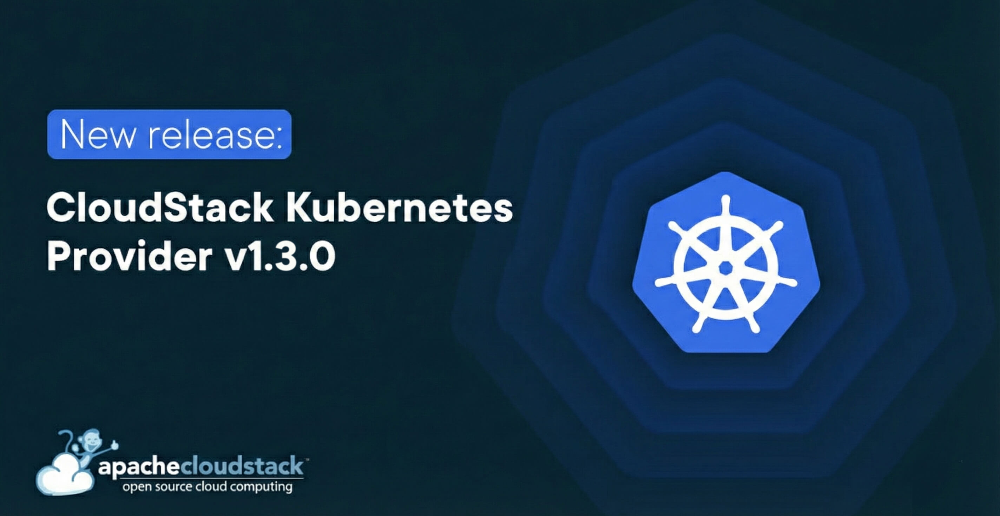

The Apache CloudStack project is pleased to announce the release of
[CloudStack Kubernetes Provider
v1.3.0](https://github.com/apache/cloudstack-kubernetes-provider/releases/tag/v1.3.0)
that facilitates Kubernetes deployments on CloudStack.

It allows Kubernetes to dynamically allocate IP addresses and the
respective networking rules on CloudStack to ensure seamless TCP, UDP
and TCP-Proxy LoadBalancer deployments on Kubernetes. This was
historically part of the Kubernetes codebase which was later removed
and donated to the project to allow for further maintenance of the
provider plugin.

This release contains various bug fixes and improvements. Some of the
highlighted features include:
* Support for load balancer stickiness policies
* CloudStack version detection that works with non-admin accounts,
  and an optional `version` setting
* Separate Network ACL rules for each Service on VPC networks
* In-place updates of load balancer rules when the proxy protocol is
  turned on or off
* Support for environments with more VMs than the CloudStack API
  returns in one page
* End-to-end tests against the CloudStack simulator in CI

If your load balancers are on VPC networks, read the
[upgrade notes](https://github.com/apache/cloudstack-kubernetes-provider/blob/v1.3.0/README.md#upgrading)
before upgrading.

<!-- truncate -->

# Documentation

* https://github.com/apache/cloudstack-kubernetes-provider/blob/v1.3.0/README.md
* https://docs.cloudstack.apache.org/en/latest/plugins/cloudstack-kubernetes-provider.html

# Downloads

The official source code for the v1.3.0 release can be downloaded from
the downloads page:
https://cloudstack.apache.org/downloads#cloudstack-kubernetes-provider-release

Changelog for this release can be found here:
https://github.com/apache/cloudstack-kubernetes-provider/releases/tag/v1.3.0

In addition to the official source code release, the container image
is available here:
https://hub.docker.com/r/apache/cloudstack-kubernetes-provider/tags?name=v1.3.0
